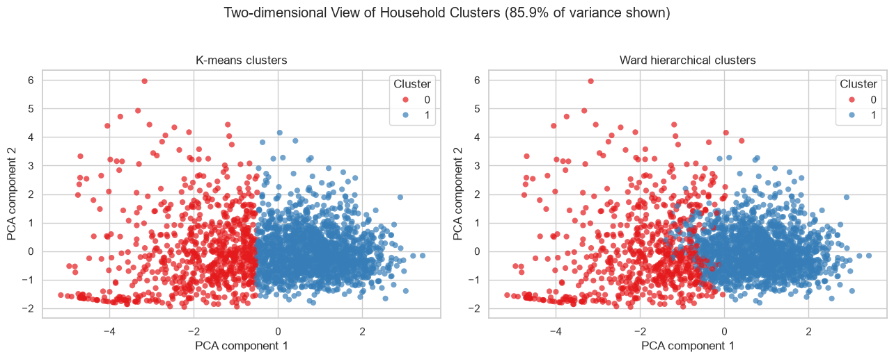
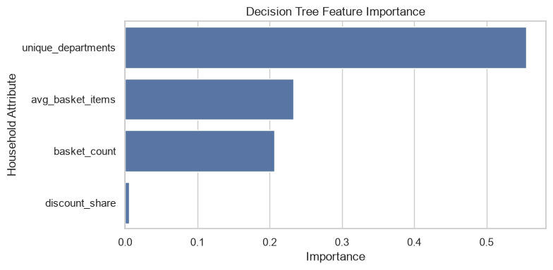
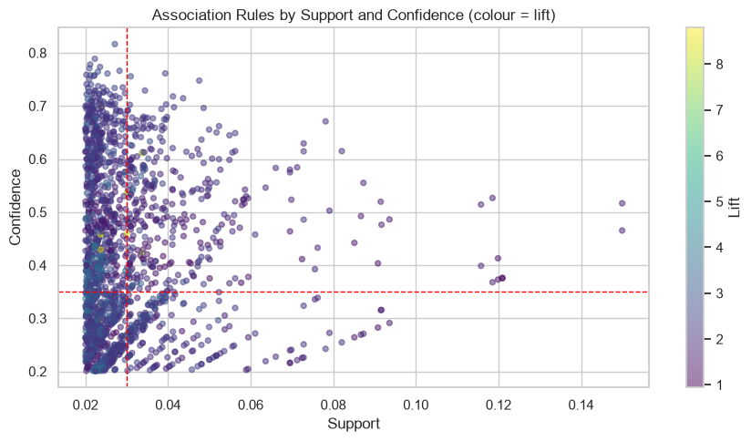
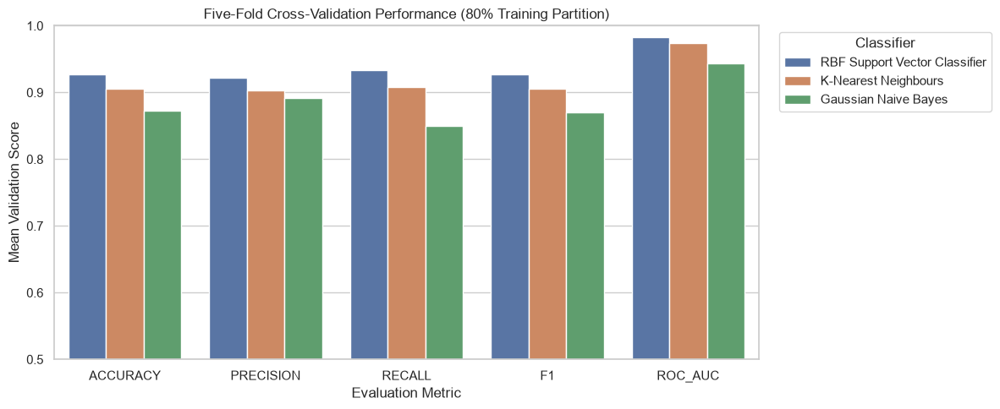

# Grocery Retail Data Mining and Customer Analytics

A collaborative Conestoga College data-mining project using the **dunnhumby Complete Journey** retail transaction dataset. The workflow uses a SQLite warehouse and Python notebooks to study household shopping behaviour, customer segmentation, market-basket relationships, and predictive models.

**Stack:** Python · pandas · NumPy · SQLite/SQL · scikit-learn · mlxtend · Matplotlib · Seaborn · Jupyter

> **Reproduction status:** Both notebooks ran to completion on a reconstructed 20,000-basket sample on November 10, 2026 (as reported by the notebook execution outputs). The figures and numerical results below are from **that run**, not the original coursework sample. Source data and generated SQLite files are excluded from this repository.

## What the project does

1. **Prepare and validate data:** sample whole shopping baskets, create the SQLite fact/dimension warehouse, handle missing values, examine outliers, and write prepared analysis tables.
2. **Segment households:** compare K-means and Ward hierarchical clustering using standardized household shopping features.
3. **Explain spending:** fit a pruned decision tree and examine which shopping behaviours distinguish higher- versus lower-spending households.
4. **Find product associations:** mine frequent itemsets and market-basket rules using support, confidence, and lift.
5. **Compare classification models:** evaluate Gaussian Naive Bayes, K-nearest neighbours, and an RBF support vector classifier using cross-validation and a held-out test set.

## Results from the reconstructed sample

The deterministic sampling script selected **20,000 complete baskets** (186,862 transaction lines). The first notebook created a SQLite fact table and dimensions (including 92,353 products and 706 day/week pairs) and produced a formatted analysis table of 185,828 records after documented filtering and processing.

### Household segmentation

The model-building notebook produced **2,317 household feature rows**. The best tested cluster count was **two**.

| Clustering measure | Result |
| --- | ---: |
| K-means silhouette score | 0.388 |
| Ward hierarchical silhouette score | 0.379 |
| Adjusted Rand index between clusterings | 0.791 |

| K-means segment | Households | Mean total spend | Mean basket items | Mean departments |
| --- | ---: | ---: | ---: | ---: |
| Lower activity | 728 | $42.04 | 5.73 | 3.20 |
| Higher activity | 1,589 | $317.89 | 17.73 | 7.41 |



### Decision-tree spending analysis

A decision tree predicting spending above/below the sample household median ($149.30) achieved **87.9% test accuracy** on 464 held-out households (maximum depth five). Its largest feature importance scores were **unique departments (0.555)**, **average items per basket (0.233)**, and **basket count (0.206)**; discount share contributed **0.006**. These are associations rather than causal effects.



### Association rules

After filtering to baskets with at least two different commodity categories, the analysis considered **15,072 baskets** and **301 commodities**. Apriori yielded **934 frequent itemsets** at minimum support 2%, resulting in **1,756 candidate rules**; **299** met combined thresholds of support at least 3%, confidence at least 35%, and lift at least 1.5.

| Selected association | Support | Confidence | Lift |
| --- | ---: | ---: | ---: |
| Pasta sauce → dry noodles/pasta | 3.0% | 53.7% | 8.204 |
| Cheeses → deli meats | 3.4% | 61.1% | 7.669 |



### Classification comparison

The RBF support vector classifier had the strongest mean cross-validation accuracy among the three models tested and achieved **89.2% held-out test accuracy**, **0.894 F1**, and **0.972 ROC-AUC**.

| Model | 5-fold CV accuracy | Held-out test accuracy |
| --- | ---: | ---: |
| RBF Support Vector Classifier | 0.927 | 0.892 |
| K-nearest neighbours | 0.906 | 0.881 |
| Gaussian Naive Bayes | 0.873 | 0.838 |



**Interpretation:** Shopping breadth, purchasing volume, and cross-department combinations showed stronger signals than blanket discount use in this sample. These findings are exploratory; causal marketing claims would require controlled experiments.

## Run locally

1. Obtain an authorized copy of the dunnhumby dataset containing `transaction_data.csv` and `product.csv`. **Do not commit the source or generated data to GitHub.**
2. Run the sampler from the repository root, pointing to the local ZIP:

   ```powershell
   py -3.11 prepare_data.py "C:\path\to\datasets.zip"
   ```

3. Set up JupyterLab from the repository root:

   ```powershell
   py -3.11 -m venv .venv
   .\.venv\Scripts\python.exe -m pip install -r requirements.txt
   .\.venv\Scripts\python.exe -m jupyter lab
   ```

4. Run `notebooks/01_data_preparation.ipynb`, then `notebooks/02_data_mining_models.ipynb`. Both notebooks resolve the `data/` directory from either the repository root or the `notebooks/` directory.

See [DATA_SETUP.md](DATA_SETUP.md) for exact sampling counts, file names, and limitations. The notebooks in this repository have execution outputs cleared to avoid publishing local machine paths and embedded data; the displayed figures above were saved from the completed run.

## Repository organization

```text
notebooks/
  01_data_preparation.ipynb
  02_data_mining_models.ipynb
docs/images/            # Selected charts from the reproduced run
data/.gitkeep          # Dataset directory placeholder; contents ignored
prepare_data.py        # Deterministic complete-basket sampling
DATA_SETUP.md          # Dataset requirements and reproduction notes
requirements.txt
.gitignore
```

## Credits and publication scope

**PROG74030 — Data Mining, Conestoga College (2026), Group 5.** Collaborative coursework by **Bradley Krawchyk, Ekam Lally, Tanishk Sharma, and Adam Wajda**. Specific implementation ownership was not independently confirmed, so the work is attributed to the group rather than claiming one person's sole authorship.

The original course report used a **different** 20,000-basket sample (190,161 transaction records); its metrics should not be conflated with those reproduced here. Source data is not redistributed. Confirm collaborator permission and the applicable dataset terms before public release.
